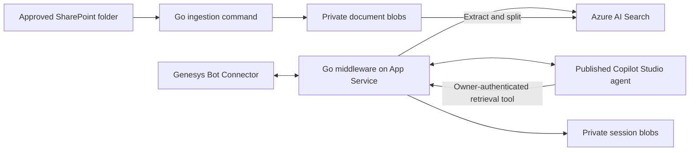

# Genesys Cloud CX + Copilot Studio

Go middleware connecting Genesys Bot Connector to an existing Copilot Studio
agent, hosted as a Linux container on Azure App Service.

**v1 scope:** customer-facing, text-only question answering. All customers can
use the same explicitly approved SharePoint knowledge without Microsoft sign-in.
Human-agent handoff is phase 2; voice and Azure Speech STT/TTS are future work.
Channel provisioning, including WhatsApp, is outside this repository's v1 scope.

## Architecture



Copilot Studio generates the answer; Go handles transport, durable conversation
mapping, and retrieval. The knowledge path is **not** native SharePoint knowledge
under the customer's identity. A backend identity ingests approved documents.
The middleware's Search identity reads only the resulting customer-facing index.

## Start here

1. Read [architecture and limitations](docs/architecture.md).
2. Follow [Azure and SharePoint setup](docs/azure-setup.md).
3. Configure the [Copilot retrieval topic and Direct Line connection](docs/copilot-studio.md).
4. Configure [Genesys Bot Connector](docs/genesys.md).
5. Complete the [acceptance checklist](docs/acceptance.md) before exposing the bot.

The code and local contract tests do not provision resources, publish the agent,
or prove a live tenant integration. Azure, Copilot, and Genesys setup is required.

## Development

Requires Go 1.26 or newer. The Azure Identity SDK and its core types supply
credentials; protocol adapters use HTTP APIs.

```sh
make test
make build
```

For local operation, copy `.env.example` to `.env`, fill in your configuration,
authenticate to Azure with the appropriate identity, and export the settings:

```sh
set -a
. ./.env
set +a
go run ./cmd/middleware
```

Do not source environment files from untrusted sources. The service fails startup
when mandatory settings are missing. `.env` is ignored by both Git and Docker.
Use Key Vault references rather than plaintext secrets in App Service settings.

| Command | Purpose |
|---|---|
| `go run ./cmd/middleware` | Serve Genesys requests and the protected retrieval API |
| `go run ./cmd/searchsetup` | Create/update this solution's index, data source, split skillset, and indexer |
| `go run ./cmd/ingest` | Synchronize one approved folder, including removals, and request an indexer run |

`searchsetup` and `ingest` are operator commands, not public HTTP endpoints.
Run ingestion manually initially; schedule it with an approved job runner when
you decide the required document-refresh cadence. The Search indexer runs every
15 minutes, but that schedule **does not** fetch changes from SharePoint.

## HTTP endpoints

| Endpoint | Authentication | Purpose |
|---|---|---|
| `GET /healthz` | None | Process liveness only; not a dependency readiness check |
| `POST /genesys/utterance` | `Authorization: Bearer <GENESYS_API_KEY>` | Genesys text turn |
| `POST /knowledge/search` | `X-API-Key: <KNOWLEDGE_API_KEY>` | Copilot's backend retrieval tool |

The two API keys must be different and at least 32 characters long. No browser
client should receive either key or the Direct Line secret.

## Important v1 boundaries

- Text only: no audio, attachments, cards, transactional actions, or handoff.
- One configured agent, integration, and approved SharePoint folder per deployment.
- Keyword search over document chunks; no embedding model or Azure OpenAI deployment
  is required. Retrieval quality must be evaluated on your actual questions.
- PDF, DOCX, PPTX, XLSX, TXT, Markdown, and HTML files up to 16 MiB. Search performs
  extraction; scanned PDFs need OCR, which is not included. Encrypted or unreadable
  documents must be corrected before launch.
- Live cloud credentials, tenant licensing/DLP approval, actual Genesys timeout
  limits, and production acceptance are still deployment prerequisites.